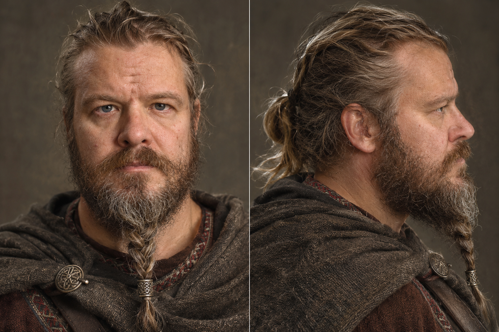

# Ван Тенерус — эталон персонажа

**Раздел:** Отдел PR → Персонажи  
**Статус:** канонический портрет загружен и проверен 15 ноября 2026 года.

Ван Тенерус — вымышленный древнерусский варяг X века, персонаж фотореалистических исторических иллюстраций. Первый сюжет — на берегу Золотого Рога у Константинополя. Для следующих сцен использовать утверждённый ниже портрет как главный визуальный референс.

## Канонический портрет

- **Основной файл:** [van-tenerus-reference.png](./van-tenerus-reference.png).
- **Ракурсы:** анфас и профиль.
- **Формат и размер:** PNG, 1536 × 1024 пикселя.
- **Git blob SHA:** `6d4fc395d45948ec648041373536c780676de5c6`.
- В папке также находится идентичная копия `380b82bb-2eb7-42e8-b9dc-1252bc7cca7a.png`; в дальнейшей работе ссылаться на файл с понятным именем.

## Устойчивые черты

- Взрослый мужчина с крепким сложением и выражением сдержанной, внимательной суровости.
- Светлые серо-голубые глаза, характерная форма носа, естественная асимметрия лица; не идеализировать черты.
- Русо-каштановые с проседью волосы, убранные назад в хвост.
- Густая борода с заметной сединой в нижней части, заплетённая в косу.
- Для исторических сюжетов — повседневная одежда варяга: грубая туника, пояс, шерстяной плащ с застёжкой.
- Сохранять анатомические пропорции и индивидуальную геометрию лица при смене ракурса, освещения и обстановки.

## Применение

Для новой сцены недостаточно одного имени: **прикладывать канонический PNG как референс**. Имена, одежда, фон и сюжет допускают изменения по заданию, но узнаваемость лица должна сохраняться. Изображения могут быть похожими, а не пиксельно идентичными.

## История версии

Первоначальный портрет с более пожилым седобородым героем был заменён новым утверждённым визуальным эталоном. Первая сюжетная иллюстрация уже опубликована; при возвращении к аналогичным сценам использовать новый портрет.
